  

  
  
  
  

## `> whoami`

Construo sistemas digitais com **visão**. Aprendo rápido, amplio o escopo técnico quando o problema exige e conecto **código, operação e automação** para entregar produtos web claros e intencionais.

Não faço só telas: faço comportamento digital.

## `> stack`

| Camada | Tecnologias |
| :-- | :-- |
| **Front-end** | TypeScript · React · Next.js · Tailwind CSS · animação e motion |
| **Back-end** | Node.js · APIs REST · autenticação · integrações · lógica de servidor |
| **Dados** | PostgreSQL · Supabase · modelagem de dados · dashboards · BI · Excel avançado |
| **Automação** | Scripts · workflows operacionais · Lua (FiveM) |
| **Cloud & DevOps** | Git · GitHub · Vercel · deploy, builds e ambientes |
| **IA** | Claude · ChatGPT · Gemini · Lovable · prompt engineering · desenvolvimento assistido por IA |
| **Design** | Direção de UI · design systems · identidade visual · glassmorphism · motion |

  
  
  
  
  
  
  
  
  
  
  

## `> projects`

| Projeto | O que é | Status |
| :-- | :-- | :-- |
| **Premium Coffee Store** | E-commerce de café premium: marca, checkout, produto e desenvolvimento | 🟡 Em andamento |
| **Spreadsheet Flow** | Sistema interno para organizar fluxos corporativos baseados em planilhas, com governança | 🟡 Em andamento |
| **ZORDAN.dev System** | Meu portfólio tratado como produto, com design system e motion próprios | 🟢 Contínuo |
| **FiveM / Lua Systems** | Scripts, lógica e integrações para ambientes dedicados | 🧪 Experimental |
| **Pricing Calculator** | SaaS para simular custos, taxas, margens e cenários | 💡 Conceito |
| **Micro SaaS Retrospectivas** | Registro e revisão de ciclos de trabalho | 💡 Conceito |
| **Site corporativo (geradores)** | Presença digital e SEO básico para empresa de geradores | ✅ Entregue |

## `> languages`

🇧🇷 Português (fluente) · 🇺🇸 Inglês (avançado) · 🇪🇸 Espanhol (avançado) · 🇯🇵 Japonês (estudando)

  

🌐 <a href="https://zordan-dev2.vercel.app">zordan-dev2.vercel.app</a>

